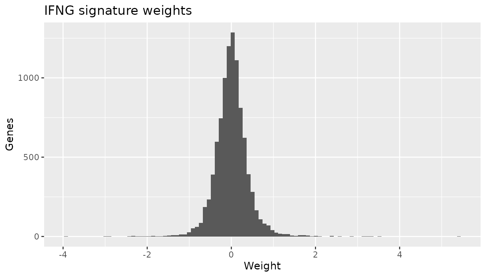
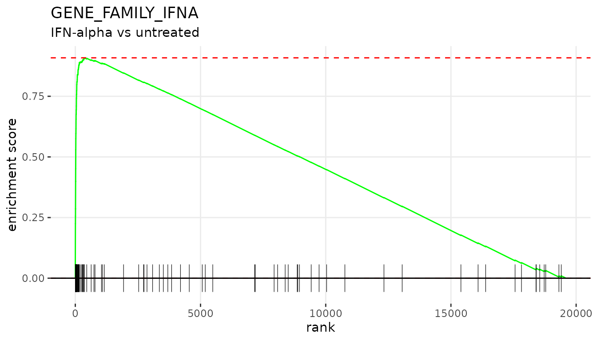
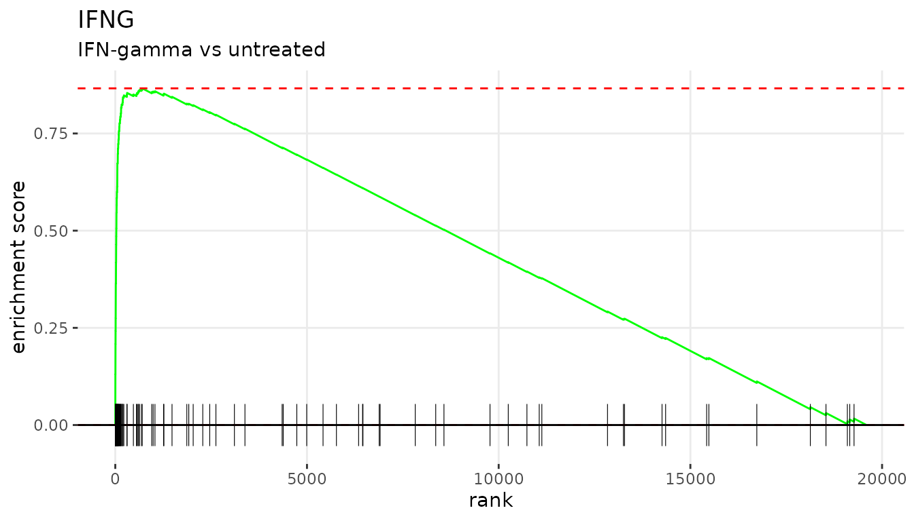

# Enrichment analysis with perturbation signatures

`pertsig` provides perturbation signatures: per-gene logistic regression
weights that describe the transcriptional response to a perturbation (a
drug, a cytokine, a gene knockout and so on).
[`getGeneSets()`](https://alserglab.github.io/pertsig/reference/getGeneSets.md)
turns each signature into gene sets of its top-weighted genes, which can
be tested against a differential expression (DE) profile with
[fgsea](https://bioconductor.org/packages/fgsea/).

## Installation

``` r

# install.packages("remotes")
remotes::install_github("alserglab/pertsig")
```

``` r

library(pertsig)
library(fgsea)
library(GEOquery)
library(limma)
library(data.table)
library(ggplot2)
```

## Loading signatures

Signatures are available for human (`"hsa"`) and mouse (`"mmu"`). The
file is downloaded once and cached. Rows can be named by gene symbol or
Entrez ID; here we use gene symbols to match the microarray annotation
below.

``` r

signatures <- loadSignatures("hsa", geneId = "symbol")
dim(signatures)
#> [1] 9733  165
head(colnames(signatures), 10)
#>  [1] "12_O_TETRADECANOYLPHORBOL_13_ACETATE"
#>  [2] "17_BETA_ESTRADIOL"                   
#>  [3] "1_25_DIHYDROXYVITAMIN_D3"            
#>  [4] "2_3_7_8_TETRACHLORODIBENZO_P_DIOXIN" 
#>  [5] "2_DEOXY_D_GLUCOSE"                   
#>  [6] "4_HYDROXYTAMOXIFEN"                  
#>  [7] "4_THIOURIDINE"                       
#>  [8] "5_AZA_2_DEOXYCYTIDINE"               
#>  [9] "5_AZACYTIDINE"                       
#> [10] "5_FLUOROURACIL"
```

Each column is one perturbation. Weights are signed: positive weights
mark genes that go up after the perturbation and negative weights mark
genes that go down.

``` r

ggplot(data.frame(weight = signatures[, "IFNG"]), aes(weight)) +
    geom_histogram(bins = 100) +
    labs(title = "IFNG signature weights", x = "Weight", y = "Genes")
```



The top 50 genes of the IFNG signature:

``` r

getGeneSets(signatures, topK = 50)[["IFNG"]]
#>  [1] "IRF1"     "GBP1"     "WARS1"    "APOL6"    "GBP4"     "CD74"    
#>  [7] "SOCS3"    "TAP1"     "PLAAT4"   "STAT1"    "IDO1"     "C1S"     
#> [13] "CYP24A1"  "GBP5"     "UBE2L6"   "C1R"      "GBP3"     "SBNO2"   
#> [19] "PARP14"   "PLGRKT"   "TAP2"     "PSMB10"   "HLA-E"    "APOL3"   
#> [25] "CD274"    "PSMB8"    "SERPINB1" "CXCL9"    "GBP2"     "HAPLN3"  
#> [31] "APOL2"    "CSF1"     "IL32"     "ETV5"     "LAP3"     "ICAM1"   
#> [37] "SERPING1" "LGALS3BP" "PSAT1"    "IL18BP"   "TGM2"     "SECTM1"  
#> [43] "PCK2"     "PIM1"     "TAPBP"    "PSMB9"    "TWF1"     "PSME2"   
#> [49] "VAMP5"    "NLRC5"
```

## Example dataset

[GSE41291](https://www.ncbi.nlm.nih.gov/geo/query/acc.cgi?acc=GSE41291)
is a microarray time course of the HSG cell line, untreated or treated
with IFN-alpha or IFN-gamma, in triplicate. We use the 4-hour samples
and make two DE comparisons: IFN-alpha vs untreated and IFN-gamma vs
untreated.

``` r

gse <- getGEO("GSE41291", AnnotGPL = TRUE)[[1]]
gse$condition <- sub("^HSG (\\S+) .*$", "\\1", gse$title)
gse$time <- sub("^HSG \\S+ (\\S+) rep\\d+$", "\\1", gse$title)

gse4hr <- gse[, gse$time == "4hr"]
table(gse4hr$condition)
#> 
#>  IFNalpha  IFNgamma untreated 
#>         3         3         3
```

## Differential expression

``` r

condition <- factor(gse4hr$condition, levels = c("untreated", "IFNalpha", "IFNgamma"))
design <- model.matrix(~ 0 + condition)
colnames(design) <- levels(condition)

contrasts <- makeContrasts(IFNalpha = IFNalpha - untreated,
                           IFNgamma = IFNgamma - untreated,
                           levels = design)
fit <- lmFit(gse4hr, design)
fit <- eBayes(contrasts.fit(fit, contrasts))
```

fgsea needs one statistic per gene. We use the limma t-statistic, drop
probes without a unique gene symbol and keep the most highly expressed
probe of each gene:

``` r

getRanks <- function(fit, contrast) {
    de <- as.data.table(topTable(fit, coef = contrast, number = Inf))
    de <- de[!is.na(Gene.symbol) & Gene.symbol != "" &
                 !grepl("///", Gene.symbol, fixed = TRUE)]
    de <- de[order(-AveExpr)][!duplicated(Gene.symbol)]
    setNames(de$t, de$Gene.symbol)
}

ranks <- list(IFNalpha = getRanks(fit, "IFNalpha"),
              IFNgamma = getRanks(fit, "IFNgamma"))
lengths(ranks)
#> IFNalpha IFNgamma 
#>    19593    19593
```

## Making gene sets

[`getGeneSets()`](https://alserglab.github.io/pertsig/reference/getGeneSets.md)
takes the `topK` genes with the largest weights in each signature, which
are the genes that go up after the perturbation. Use
`direction = "down"` for the genes that go down, or `direction = "both"`
for both (`_UP` and `_DN` sets). Passing the genes of the DE profile as
`universe` picks the top genes among those that fgsea can use, so every
gene set keeps `topK` genes. Both comparisons come from the same arrays,
so they share one gene universe.

``` r

geneSets <- getGeneSets(signatures, topK = 100, universe = names(ranks$IFNalpha))
length(geneSets)
#> [1] 165
```

A positive NES means the DE profile goes the same way as the
perturbation; a negative NES means it goes the opposite way.

## Running fgsea

``` r

set.seed(42)
fgseaRes <- lapply(ranks, function(stats) {
    fgsea(pathways = geneSets, stats = stats)
})
```

``` r

plotTopSignatures <- function(fgseaRes, stats) {
    topUp <- fgseaRes[ES > 0][head(order(pval), n = 10), pathway]
    topDown <- fgseaRes[ES < 0][head(order(pval), n = 10), pathway]
    plotGseaTable(geneSets[c(topUp, rev(topDown))], stats, fgseaRes, gseaParam = 0.5)
}
```

### IFN-alpha vs untreated

``` r

head(fgseaRes$IFNalpha[order(pval)], 10)
#>                             pathway         pval         padj   log2err
#>                              <char>        <num>        <num>     <num>
#>  1:                GENE_FAMILY_IFNA 3.850920e-45 6.354017e-43 1.7506503
#>  2:                            IFNG 1.116002e-27 9.207015e-26 1.3651796
#>  3:                             IL6 5.782674e-22 3.180471e-20 1.2125446
#>  4:                      SARS_COV_2 6.863142e-20 2.831046e-18 1.1512205
#>  5:                          STING1 6.556916e-17 2.163782e-15 1.0574636
#>  6:                      ZIKA_VIRUS 8.418028e-16 2.314958e-14 1.0276699
#>  7:                            IL22 1.247337e-15 2.940151e-14 1.0175448
#>  8:                            MITF 5.509383e-14 1.010054e-12 0.9653278
#>  9: POLYINOSINIC_POLYCYTIDYLIC_ACID 5.509383e-14 1.010054e-12 0.9653278
#> 10:     HEPATITIS_C_VIRUS_INFECTION 1.338418e-12 2.208390e-11 0.9101197
#>            ES      NES  size                                   leadingEdge
#>         <num>    <num> <int>                                        <list>
#>  1: 0.9086312 3.650279   100    IRF9,IFIT3,IFIT1,IFIT2,HELZ2,IFI16,...[51]
#>  2: 0.8376970 3.365313   100 IRF9,SERPINB1,TGM2,STAT1,PARP9,UBE2L6,...[46]
#>  3: 0.8010650 3.218149   100 IRF9,IFI16,SERPINB1,TGM2,PARP9,PLSCR1,...[40]
#>  4: 0.7806835 3.136270   100   IFIT3,IFIT1,IFIT2,HELZ2,IFI16,ISG15,...[35]
#>  5: 0.7491926 3.009760   100     IFIT3,IFIT2,OASL,IFI44,ISG15,TGM2,...[27]
#>  6: 0.7366120 2.959220   100    IFIT3,IFIT1,IFIT2,HELZ2,OASL,ISG15,...[23]
#>  7: 0.7347480 2.951731   100 HELZ2,SERPINB1,IRF7,TGM2,SOCS2,SECTM1,...[46]
#>  8: 0.7134086 2.866004   100    IFIT3,IFIT1,HELZ2,TRIM21,OAS2,IFI6,...[20]
#>  9: 0.7133904 2.865931   100    IFIT3,IFIT1,IFIT2,HELZ2,OASL,IFI44,...[24]
#> 10: 0.6936794 2.786745   100    OASL,IFI44,ISG15,IFI44L,STAT1,IFI6,...[17]
```

``` r

plotTopSignatures(fgseaRes$IFNalpha, ranks$IFNalpha)
```


``` r

plotEnrichment(geneSets[["GENE_FAMILY_IFNA"]], ranks$IFNalpha) +
    labs(title = "GENE_FAMILY_IFNA", subtitle = "IFN-alpha vs untreated")
```



### IFN-gamma vs untreated

``` r

head(fgseaRes$IFNgamma[order(pval)], 10)
#>                    pathway         pval         padj   log2err        ES
#>                     <char>        <num>        <num>     <num>     <num>
#>  1:                   IFNG 3.068876e-38 5.063645e-36 1.6088796 0.8661303
#>  2:       GENE_FAMILY_IFNA 1.811776e-22 1.494715e-20 1.2295041 0.7750994
#>  3:                    IL6 1.481316e-21 8.147238e-20 1.2039752 0.7686371
#>  4:                   IL21 3.618890e-14 1.492792e-12 0.9653278 0.6893531
#>  5:                    IL3 2.093198e-10 6.907553e-09 0.8266573 0.6304140
#>  6:                    TNF 3.715776e-10 1.021838e-08 0.8140358 0.6262948
#>  7:                   IL22 3.158096e-09 7.444082e-08 0.7749390 0.6056923
#>  8:                    EGF 1.112219e-07 2.293952e-06 0.7049757 0.5699742
#>  9:             SARS_COV_2 3.957977e-07 7.256291e-06 0.6749629 0.5545557
#> 10: ANTIRETROVIRAL_THERAPY 5.353384e-07 8.833083e-06 0.6594444 0.5505014
#>          NES  size                                   leadingEdge
#>        <num> <int>                                        <list>
#>  1: 3.605913   100    IRF9,CXCL10,IRF1,TGM2,IL18BP,STAT1,...[54]
#>  2: 3.226929   100   IRF9,HEG1,STAT1,TRIM21,PARP9,UBE2L6,...[42]
#>  3: 3.200025   100      IRF9,TGM2,PARP9,GBP2,SECTM1,CCL2,...[38]
#>  4: 2.869946   100      IRF9,CXCL10,IRF1,HEG1,PARP9,GBP2,...[31]
#>  5: 2.624568   100     IRF9,PARP9,CCL2,PLSCR1,SOCS1,CISH,...[33]
#>  6: 2.607419   100        UBD,CXCL10,IRF1,GBP1,CCL2,TAP1,...[21]
#>  7: 2.521646   100 TGM2,SECTM1,HELZ2,CISH,SBNO2,SERPINB1,...[33]
#>  8: 2.372943   100   IRF9,IRF1,TRIB1,CXCL2,LDLR,TNFRSF1A,...[25]
#>  9: 2.308752   100   IFIT3,IFI16,HELZ2,IFIT2,CXCL2,SP110,...[34]
#> 10: 2.291873   100   PARP9,TAP1,HLA-E,HAPLN3,SOCS1,BATF2,...[22]
```

``` r

plotTopSignatures(fgseaRes$IFNgamma, ranks$IFNgamma)
```


``` r

plotEnrichment(geneSets[["IFNG"]], ranks$IFNgamma) +
    labs(title = "IFNG", subtitle = "IFN-gamma vs untreated")
```



## Mouse signatures

Mouse signatures are loaded the same way. The top 50 genes of the IFNG
signature:

``` r

mouseSignatures <- loadSignatures("mmu", geneId = "symbol")
dim(mouseSignatures)
#> [1] 9624  266
getGeneSets(mouseSignatures, topK = 50)[["IFNG"]]
#>  [1] "Gbp2"    "Ly6a"    "Igtp"    "Hspa1b"  "Iigp1"   "Cd74"    "Cyp2b10"
#>  [8] "Irf1"    "Psmb8"   "Gbp7"    "Blvrb"   "H2-DMa"  "Tap1"    "Socs1"  
#> [15] "Ephx1"   "Stat1"   "Mt2"     "Irf8"    "Me1"     "Tgtp1"   "Psmb9"  
#> [22] "Gbp6"    "Irgm1"   "Irgm2"   "H2-Aa"   "Ifi47"   "Gbp4"    "Slc7a11"
#> [29] "Gbp8"    "Tap2"    "Ly6c1"   "Cyp1a1"  "H2-Ab1"  "Bach2"   "Tapbp"  
#> [36] "Zbp1"    "Gbp3"    "H2-K1"   "Jun"     "Bcl2"    "Cxcl10"  "Insl6"  
#> [43] "Cd274"   "Psmb10"  "Abcc4"   "Cxcl9"   "Abhd2"   "Uchl1"   "H2-D1"  
#> [50] "Ggct"
```

## Session info

``` r

sessionInfo()
#> R version 4.6.2 (2026-10-29)
#> Platform: x86_64-pc-linux-gnu
#> Running under: Ubuntu 24.04.5 LTS
#> 
#> Matrix products: default
#> BLAS:   /usr/lib/x86_64-linux-gnu/openblas-pthread/libblas.so.3 
#> LAPACK: /usr/lib/x86_64-linux-gnu/openblas-pthread/libopenblasp-r0.3.26.so;  LAPACK version 3.12.0
#> 
#> locale:
#>  [1] LC_CTYPE=C.UTF-8       LC_NUMERIC=C           LC_TIME=C.UTF-8       
#>  [4] LC_COLLATE=C.UTF-8     LC_MONETARY=C.UTF-8    LC_MESSAGES=C.UTF-8   
#>  [7] LC_PAPER=C.UTF-8       LC_NAME=C              LC_ADDRESS=C          
#> [10] LC_TELEPHONE=C         LC_MEASUREMENT=C.UTF-8 LC_IDENTIFICATION=C   
#> 
#> time zone: UTC
#> tzcode source: system (glibc)
#> 
#> attached base packages:
#> [1] stats     graphics  grDevices utils     datasets  methods   base     
#> 
#> other attached packages:
#> [1] ggplot2_4.0.3       data.table_1.18.6.1 limma_3.68.5       
#> [4] GEOquery_2.80.1     Biobase_2.72.0      BiocGenerics_0.58.1
#> [7] generics_0.1.4      fgsea_1.38.0        pertsig_0.1.0      
#> 
#> loaded via a namespace (and not attached):
#>  [1] SummarizedExperiment_1.42.0 fastmatch_1.1-8            
#>  [3] gtable_0.3.6                httr2_1.3.0                
#>  [5] xfun_0.62                   bslib_0.12.0               
#>  [7] lattice_0.23-1              tzdb_0.5.0                 
#>  [9] vctrs_0.7.3                 tools_4.6.2                
#> [11] curl_8.1.0                  stats4_4.6.2               
#> [13] parallel_4.6.2              tibble_3.3.1               
#> [15] R.oo_1.27.1                 pkgconfig_2.0.3            
#> [17] Matrix_1.7-6                rentrez_1.2.4              
#> [19] RColorBrewer_1.1-3          S7_0.2.2                   
#> [21] desc_1.4.3                  S4Vectors_0.50.3           
#> [23] lifecycle_1.0.5             compiler_4.6.2             
#> [25] farver_2.1.2                textshaping_1.0.5          
#> [27] statmod_1.5.2               Seqinfo_1.2.0              
#> [29] codetools_0.2-20            htmltools_0.5.9            
#> [31] sass_0.4.10                 yaml_2.3.12                
#> [33] tidyr_1.3.2                 pillar_1.11.1              
#> [35] pkgdown_2.2.1               jquerylib_0.1.4            
#> [37] R.utils_2.13.0              BiocParallel_1.46.0        
#> [39] cachem_1.1.0                DelayedArray_0.38.2        
#> [41] abind_1.4-8                 tidyselect_1.2.1           
#> [43] digest_0.6.39               purrr_1.2.2                
#> [45] dplyr_1.2.1                 labeling_0.4.3             
#> [47] cowplot_1.2.0               fastmap_1.2.0              
#> [49] grid_4.6.2                  cli_3.6.6                  
#> [51] SparseArray_1.12.3          magrittr_2.0.5             
#> [53] S4Arrays_1.12.1             XML_3.99-0.25              
#> [55] withr_3.0.3                 readr_2.2.0                
#> [57] scales_1.4.0                rmarkdown_2.32             
#> [59] XVector_0.52.0              matrixStats_1.5.0          
#> [61] otel_0.2.0                  R.methodsS3_1.8.2          
#> [63] hms_1.1.4                   ragg_1.5.2                 
#> [65] evaluate_1.0.5              knitr_1.52                 
#> [67] GenomicRanges_1.64.0        IRanges_2.46.0             
#> [69] rlang_1.3.0                 Rcpp_1.1.2                 
#> [71] glue_1.8.1                  xml2_1.6.0                 
#> [73] jsonlite_2.0.0              R6_2.6.1                   
#> [75] MatrixGenerics_1.24.0       systemfonts_1.3.2          
#> [77] fs_2.1.0
```
